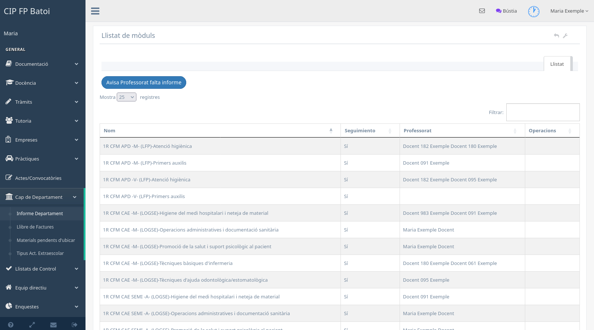

# Manual del cap de departament

Este manual explica les funcions específiques del cap de departament. El rol és
acumulatiu i conserva les opcions del [professorat](manual-profe.md) i, si és el
cas, de [tutoria](manual-tutor.md).

## Reunions de departament

El cap de departament pot crear reunions de tipus departament des de
**Actes/Convocatòries → Gestió de reunions**. El flux és el mateix que per a
altres reunions:

1. definir data, número, espai i objectiu;
2. revisar participants i ordre del dia;
3. enviar la convocatòria;
4. emplenar els acords després de la reunió;
5. generar i arxivar l'acta quan siga definitiva.

Cal guardar cada resum abans d'abandonar l'edició. L'arxiu documental s'ha de
fer quan l'acta ja no requerisca correccions.

## Informe de departament

La pantalla **Cap de departament → Informe departament** mostra els mòduls del
departament i si tenen el seguiment de l'avaluació completat.

La taula permet:

- identificar el mòdul i el professorat responsable;
- comprovar si s'ha lliurat el seguiment;
- avisar individualment quan falta informació;
- avisar conjuntament el professorat pendent;
- generar l'informe trimestral quan totes les dades necessàries estan
  disponibles;
- recuperar el PDF de l'informe ja generat.

Els avisos no substituïxen la revisió del contingut. Abans de generar l'informe
cal comprovar que els seguiments corresponen a l'avaluació correcta.

## Llibre de factures

Esta opció permet gestionar els lots o registres econòmics assignats al
departament. Les accions disponibles depenen de l'estat del lot i dels permisos
del curs. Cal conservar els justificants i seguir el circuit administratiu del
centre.

## Materials pendents d'ubicar

Mostra el material inventariable relacionat amb el departament que encara
necessita ubicació o revisió. El cap pot completar la informació que li
correspon, però les operacions generals d'inventari continuen depenent dels
rols de manteniment o administració.

## Tipus d'activitat

El cap de departament pot mantindre els tipus d'activitat propis del seu àmbit.
La classificació ha de distingir clarament:

- activitat **complementària** o **extraescolar**;
- activitat dins o fora del centre;
- necessitat de transport quan es realitza fora;
- justificació de resultats d'aprenentatge per a les complementàries.

Modificar un tipus afecta els formularis i la informació que veuran el
professorat i Direcció, per la qual cosa s'ha de revisar abans de guardar-lo.
