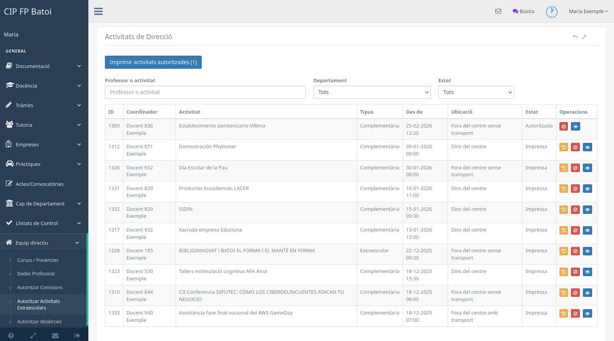
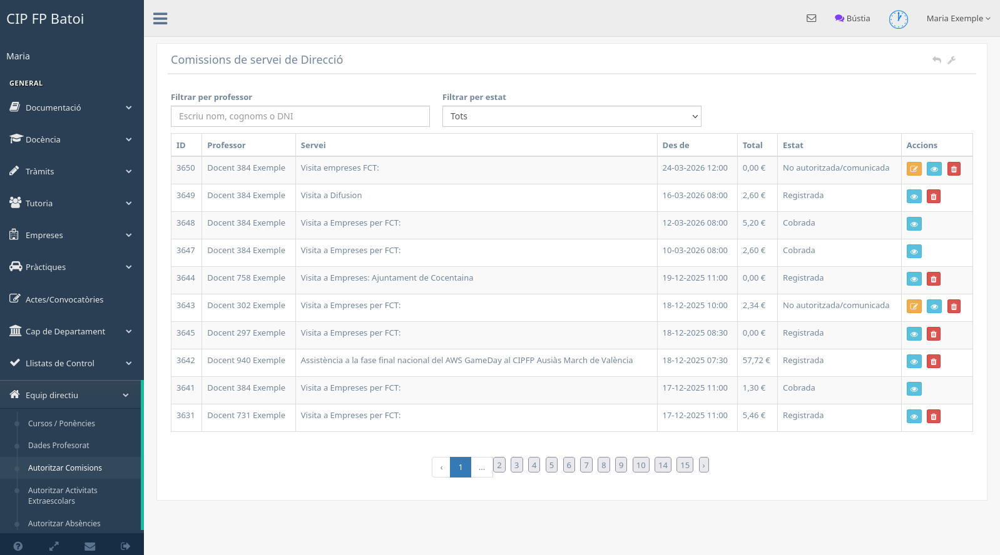
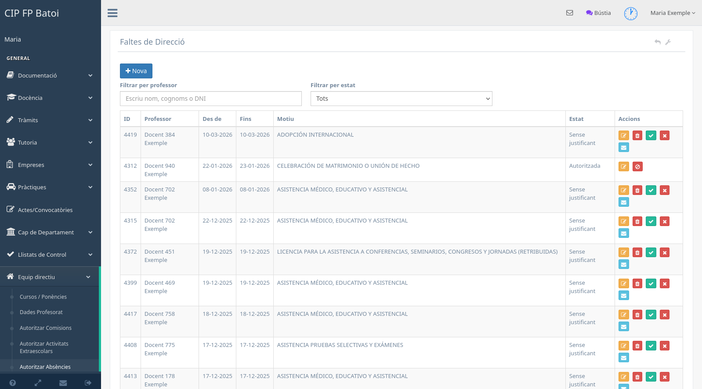
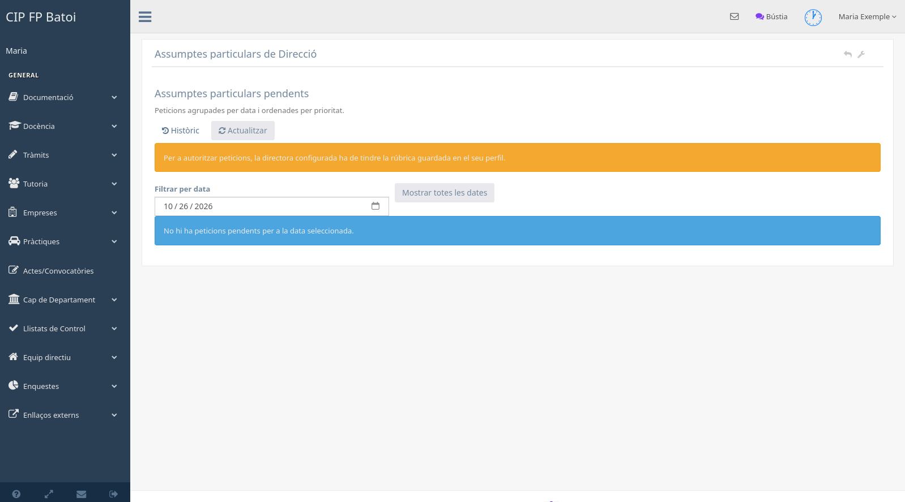
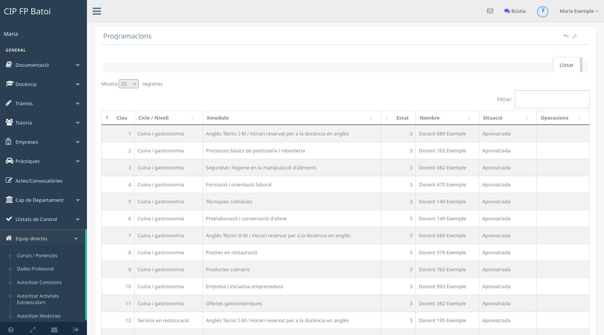
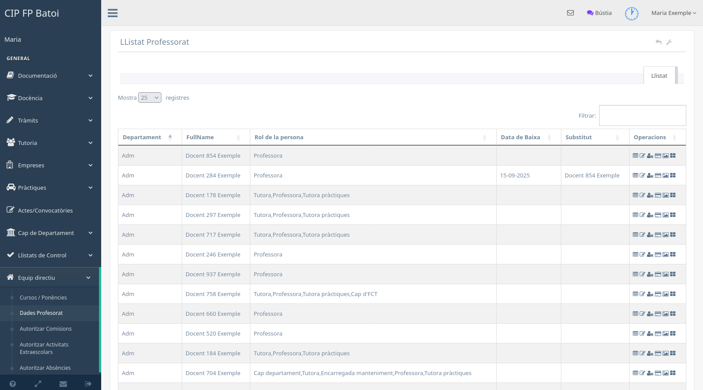

# Manual de Direcció

Este manual resumix els panells específics de Direcció. Les opcions docents
comunes continuen explicades en el [manual del professorat](manual-profe.md).

## Criteri general de treball

Els panells de Direcció mostren informació de tot el centre i permeten canviar
estats administratius. Abans d'autoritzar, rebutjar o imprimir en bloc cal:

1. aplicar els filtres necessaris;
2. obrir el detall del registre;
3. comprovar dates, participants, documents i estat;
4. confirmar que l'acció correspon al conjunt seleccionat.

Els botons disponibles canvien segons l'estat. Un registre imprés, resolt o
tancat pot deixar de ser editable.

## Activitats

El panell **Equip directiu → Autoritzar activitats** permet filtrar per
professor o activitat, departament i estat.

La taula mostra el coordinador real, el tipus —complementària o extraescolar—,
la data, la ubicació i l'estat. Des del detall es revisen participants, grups,
objectius i, només en les complementàries, la justificació dels resultats
d'aprenentatge.

Segons l'estat es pot autoritzar, tornar a l'estat anterior, rebutjar amb un
motiu, marcar la gestió en ITACA o imprimir les activitats autoritzades.

## Comissions de servei

El panell **Equip directiu → Autoritzar comissions** permet filtrar per
professor i estat, revisar imports i resoldre les comissions.

Direcció pot autoritzar o rebutjar les pendents, tornar una autorització a
pendent quan el flux ho permet, consultar el detall i imprimir les comissions
autoritzades. La zona de pagaments agrupa per professor les comissions pendents
de cobrament i genera la documentació del conjunt seleccionat.

## Absències

El panell **Equip directiu → Autoritzar absències** centralitza les
comunicacions del professorat.

Cal revisar el període, el motiu, les observacions i el justificant abans de
resoldre. Segons l'estat es pot autoritzar, rebutjar motivadament, consultar el
document o completar les accions administratives disponibles.

## Assumptes particulars

El panell mostra les peticions pendents agrupades per data i ordenades segons
els criteris de prioritat del sistema.

Per defecte es consulta la data situada set dies naturals després de hui. Es
pot seleccionar una altra data o mostrar-les totes. Abans d'autoritzar, la
pantalla comprova calendari, saldo, consecutivitat, contingent i torn.

L'autorització només està disponible dins del termini. Si el dia que obri el
termini és festiu, es pot autoritzar des del laborable anterior; un dia no
lectiu no avança el termini. Per generar la resolució cal que el professor i la
directora configurada tinguen la rúbrica gràfica guardada.

La denegació requerix un motiu. L'opció **Històric** permet consultar les
autoritzacions del curs i les regularitzacions registrades.

## Expedients

El panell d'expedients permet filtrar i revisar els tràmits enviats pel
professorat. Les accions poden incloure veure el detall, generar documents,
autoritzar o rebutjar segons el tipus i l'estat. Cal evitar resoldre en bloc
expedients que requerixen comprovacions individuals.

## Programacions

La pantalla de control mostra els mòduls, el cicle, la programació associada i
la seua situació. Permet detectar programacions no presentades o pendents i
avisar el professorat responsable. La revisió del fitxer continua sent
necessària abans de donar per completat el procés.

## Dades del professorat

La pantalla **Equip directiu → Dades professorat** permet consultar el personal
docent i accedir a operacions autoritzades sobre horaris, presència, avisos i
dades administratives.

Abans de modificar o desactivar un registre cal comprovar la identitat i la
situació del professor. Les dades de contacte i els identificadors només s'han
d'utilitzar per a les tasques de gestió del centre.

## Horaris

Direcció pot consultar les propostes temporals d'horari, revisar els moviments
i acceptar-les o rebutjar-les. Una proposta aprovada queda bloquejada per al
professorat, però no entra en vigor fins que s'aplica en el moment acordat.

També hi ha opcions per imprimir horaris i consultar el control de presència.
L'activació o desactivació d'una opció general del menú correspon al perfil
d'administració i no forma part del flux ordinari de Direcció.

## Reunions i documentació

Direcció pot consultar les reunions del centre, detectar actes pendents i
generar conjunts d'actes d'avaluació. El gestor documental de Direcció permet
consultar els documents protegits d'acord amb el seu tipus i titularitat.

## Signatures i convalidacions

El panell de signatures mostra els documents d'FCT pendents d'intervenció de
Direcció. Les convalidacions disposen d'un espai propi per revisar sol·licituds,
documents, regles i imports autoritzats. En tots dos casos s'ha de preservar el
document original i deixar constància de la resolució aplicada.
