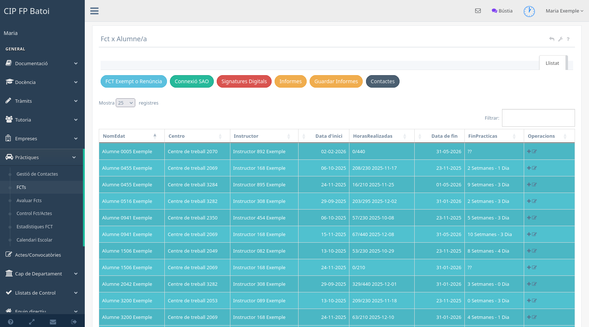

# FCT de l'alumnat

La pantalla **Pràctiques → FCT x alumne/a** reunix les pràctiques importades o
creades per al tutor i facilita l'accés a SAO, informes i signatures.

## Informació del llistat

Cada fila mostra, segons les dades disponibles:

- alumne o alumna;
- centre de treball;
- instructor;
- data d'inici;
- hores realitzades i hores previstes;
- data de finalització;
- temps aproximat restant;
- operacions sobre la pràctica.

La cerca filtra el llistat complet i les capçaleres permeten ordenar-lo. Abans
d'editar, cal confirmar que s'ha seleccionat la pràctica correcta, especialment
quan un alumne té més d'un període o està relacionat amb diversos grups.

## FCT exempta, convalidada o renúncia

El botó corresponent inicia el flux per registrar una exempció, convalidació o
situació equivalent. Estes pràctiques no s'han de classificar només pel grup:
la normativa i el cicle s'han de comprovar amb l'associació concreta de
l'alumne.

## Connexió amb SAO

El menú **Connexió SAO** agrupa les operacions d'integració disponibles, com:

- baixar o importar FCT;
- comparar dades d'empreses i centres;
- sincronitzar hores realitzades;
- baixar annexos generats o firmats.

La importació no substituïx la revisió. Després de cada operació s'han de
comprovar centre, col·laboració, instructor, dates, hores i alumnat. Si una
descàrrega automàtica falla, no s'ha de crear manualment documentació duplicada
sense verificar abans l'estat en SAO.

## Signatures digitals

Este botó obri el panell de documents pendents, des d'on es creen, envien,
descarreguen o pugen els annexos segons el tipus. El procés complet està
explicat en el [manual general d'FCT](manual-fct.md#signatures-digitals).

## Informes

El menú d'informes genera documents de selecció o seguiment, entre altres:

- control de servei;
- entrevista final amb l'instructor;
- entrevista amb l'alumnat;
- autoritzacions de situacions excepcionals;
- annexos i informes de competències.

Cada informe pot demanar seleccionar alumnat o instructors abans de generar el
PDF. Cal revisar la selecció i el període perquè la generació no modifica les
dades de la FCT.

## Operacions de cada fila

Les icones poden permetre, segons l'estat i els permisos:

- obrir el detall;
- editar dates, hores o associacions autoritzades;
- consultar o generar documents;
- importar informació relacionada;
- enviar comunicacions;
- eliminar una associació encara modificable.

Les dades de seguiment ordinari es registren en el
[panell d'FCT](manual-fct-panel.md); la qualificació final es realitza en
[Avaluar FCT](manual-fct-avaluacio.md).
