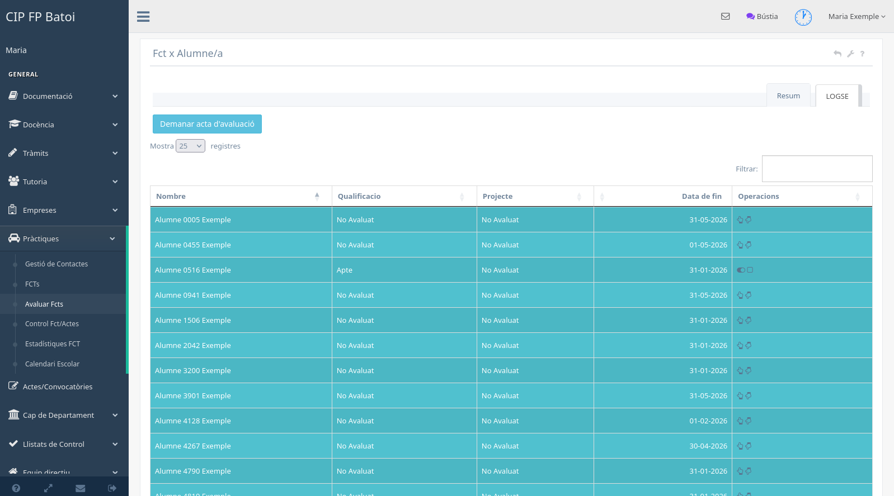

# Avaluació d'FCT

La pantalla **Pràctiques → Avaluar FCTs** mostra l'alumnat avaluable del tutor i
separa la informació segons la normativa aplicable.

## Què mostra

La taula inclou:

- alumne o alumna;
- qualificació de l'FCT;
- qualificació o estat del projecte, quan és obligatori;
- data de finalització;
- operacions disponibles.

Un alumne pot aparéixer com **No avaluat** fins que es registra la decisió. La
necessitat d'avaluar projecte depén de la normativa i del cicle; no s'ha
d'inferir només perquè l'alumne figure en un grup concret.

## Qualificar

Les accions de la fila permeten marcar l'FCT com **Apte** o **No apte** i,
segons el cas, registrar renúncia, expulsió o altres situacions previstes. Si hi
ha projecte, cal completar també la seua qualificació o documentació.

Abans de qualificar s'han de comprovar les hores, la data de finalització, els
seguiments i els documents exigits. Una correcció posterior pot afectar actes i
certificats ja generats.

## Documentació i inserció

Segons la normativa i l'estat, les operacions poden permetre:

- pujar documentació de projecte o qualitat;
- consultar informes o certificats;
- registrar si hi ha inserció laboral en l'empresa;
- modificar una nota encara oberta.

Els documents s'han d'identificar amb l'alumne i el tipus correctes. No s'han
de pujar annexos d'una altra pràctica encara que pertanguen a la mateixa
persona.

## Demanar l'acta

El botó **Demanar acta d'avaluació** inicia el procés amb Caporalia o Direcció
quan la informació requerida està completa. Abans de demanar-la cal revisar
totes les files i confirmar que no queden qualificacions pendents que hagen de
formar part de l'acta.
