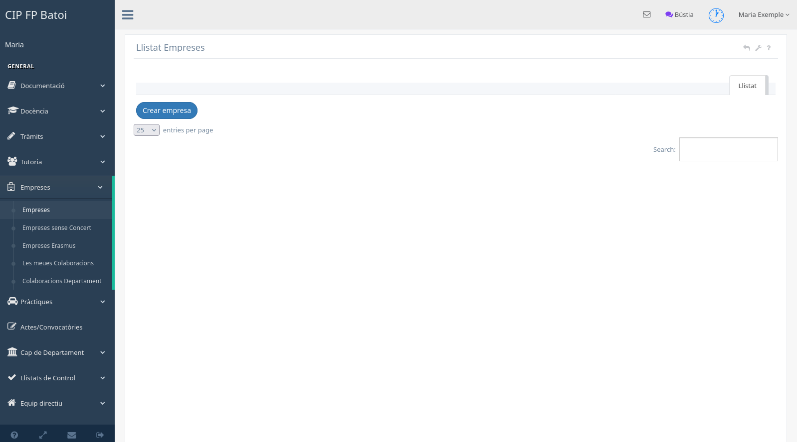

# Empreses i centres de treball d'FCT

La pantalla **Empreses → Empreses** conté el directori compartit del centre.
Abans de crear una empresa nova, cal buscar-la pel nom o pel NIF per evitar
duplicats.

## Estructura de les dades

La intranet diferencia quatre elements:

- **Empresa:** entitat jurídica, NIF, gerència i dades generals.
- **Centre de treball:** ubicació concreta on es fan les pràctiques.
- **Col·laboració:** relació d'un centre de treball amb un cicle.
- **Instructor:** persona de l'empresa que tutoritza l'alumnat.

Una empresa pot tindre diversos centres, cada centre diverses col·laboracions i
més d'un instructor. Una FCT s'associa a la col·laboració i a l'instructor
corresponents, no només al nom de l'empresa.

## Consultar i editar

Des del llistat es pot obrir el detall de l'empresa. La fitxa agrupa les dades
generals, els centres, els instructors, les col·laboracions i la documentació
disponible.

Abans de modificar cal comprovar si la dada pertany a l'empresa o només a un
centre de treball. Canviar una dada compartida afecta totes les col·laboracions
relacionades.

Les accions d'edició i eliminació depenen de les policies. El professorat tutor
pot crear i actualitzar la informació autoritzada; les eliminacions queden
reservades als perfils corresponents.

## Crear una empresa

En donar d'alta una empresa s'han d'emplenar les dades jurídiques i de contacte
amb informació verificada. La intranet crea el centre inicial i, quan es pot
determinar el cicle tutoritzat, la col·laboració inicial.

Cal revisar especialment:

- NIF i nom oficial;
- nom i NIF de la gerència en camps separats;
- telèfon, correu i adreça;
- si depén de la Generalitat Valenciana;
- localitat i, quan es disposa d'elles, coordenades del centre;
- conveni i documentació associada.

L'avís **Falta NIF del gerent** identifica una fitxa incompleta però no bloqueja
la resta del treball. En completar-lo en la fitxa de l'empresa, l'avís desapareix
de totes les col·laboracions relacionades.

## Altres llistats

- **Empreses sense concert:** contactes o entitats que encara no formen part
  del circuit ordinari de concert.
- **Empreses Erasmus:** empreses internacionals gestionades en el panell
  específic; no apareixen en les col·laboracions departamentals ordinàries.

Per a assignar, contactar i classificar empreses del cicle, consulta
[Les meues col·laboracions](manual-fct-meues-colaboracions.md).
