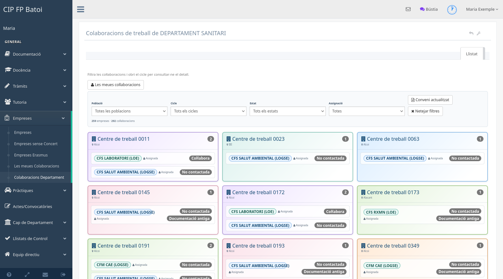

# Col·laboracions del departament

Esta pantalla oferix al professorat tutor una visió conjunta de les empreses i
centres de treball relacionats amb els cicles del seu departament. Servix per a
localitzar col·laboracions, comparar-ne l'estat i obrir-ne el detall; els
filtres no modifiquen les dades.

## Com s'hi arriba

Des del menú d'FCT, cal obrir **Contactes** o **Col·laboracions del departament**,
segons el text configurat en el menú. L'adreça d'entrada és `/colaboracion`.

## Què mostra cada fitxa

Cada empresa o centre apareix una sola vegada, encara que col·labore amb més
d'un cicle. Dins de la fitxa es mostren els cicles coincidents i la informació
necessària per identificar la relació:

- nom i població del centre de treball;
- abreviatures dels cicles;
- estat de la col·laboració;
- existència de contactes registrats;
- situació del conveni;
- professor assignat, quan n'hi ha.

Cada abreviatura de cicle té un color estable i permet obrir el detall de la
col·laboració corresponent. Les fitxes utilitzen una vora i un degradat suaus
per separar visualment una empresa de la següent. En escriptori es mostren tres
columnes; en pantalles més estretes passen a dos o una.

Les empreses Erasmus no apareixen en este llistat perquè tenen el seu panell
específic.

## Filtres acumulatius

Es poden combinar tots estos criteris:

- **Població**: agrupa variants d'un mateix municipi i mostra els noms
  canònics en majúscules, conservant els accents.
- **Cicle**: limita les fitxes a les col·laboracions del cicle seleccionat.
- **Estat**: permet distingir les col·laboracions sense contacte, contactades o
  que col·laboren.
- **Conveni actualitzat**: oculta les que encara tenen el conveni pendent.
- **Assignació**: separa les col·laboracions amb professor responsable de les
  que encara no en tenen.

Els filtres són acumulatius: una col·laboració ha de complir alhora tots els
criteris actius. Quan una empresa té diversos cicles, la fitxa continua
apareixent una sola vegada i mostra només els cicles que coincidixen amb el
filtre.

El botó **Neteja els filtres** recupera el llistat complet i actualitza el
recompte de resultats.

## Interpretació dels estats

- **Sense contacte** significa que no hi ha cap contacte registrat.
- **Contactada** significa que hi ha almenys un contacte registrat.
- **No contactada**, **No sé**, **Col·labora** i **No col·labora** són els
  estats de decisió de la col·laboració.
- **Assignada** indica que hi ha un professor tutor responsable.
- **Conveni actualitzat** indica que el conveni no està pendent de revisió.

L'estat **No sé** no implica que la col·laboració haja sigut contactada: la
marca de contacte depén exclusivament de l'existència d'un contacte registrat.

## Passar a la gestió pròpia

El botó **Les meues col·laboracions** obri el panell operatiu del tutor, on es
pot assignar, contactar i classificar les col·laboracions pròpies. Esta tasca
s'explica en [Les meues col·laboracions](manual-fct-meues-colaboracions.md).
