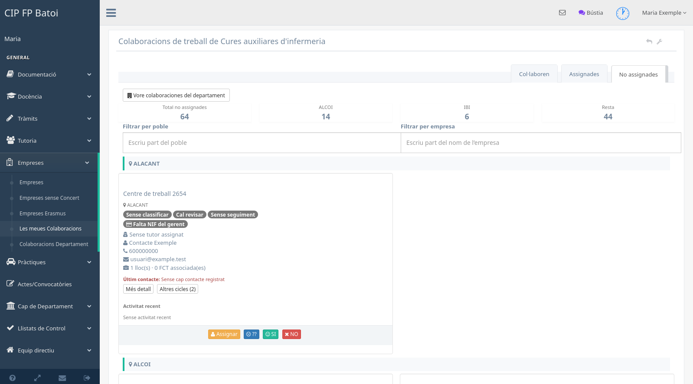

# Les meues col·laboracions

Este panell permet al tutor d'FCT treballar amb les col·laboracions del seu
cicle: repartir-les entre tutors, registrar contactes i indicar si l'empresa
col·labora durant el curs.

## Com s'hi arriba

Des de les col·laboracions del departament, cal polsar **Les meues
col·laboracions**. També es pot entrar des del menú d'FCT quan l'opció estiga
configurada. L'adreça és `/misColaboraciones`.

## Pestanyes de treball

Les pestanyes agrupen les col·laboracions segons l'estat configurat en el
panell. El nom concret pot variar, però el flux habitual distingix:

- les que encara no tenen tutor assignat;
- les assignades que estan pendents de decisió;
- les empreses que han confirmat que col·laboren;
- les que han indicat que no col·laboren, quan la configuració les mostra.

Assignar-se una col·laboració evita que diversos tutors contacten amb la
mateixa empresa sense coordinació. Una vegada assignada, es pot registrar el
contacte i classificar la resposta.

## Cercar i combinar filtres

Cada pestanya es pot filtrar per:

- **població**;
- **nom d'empresa**, escrivint una part del nom;
- **estat ràpid**, quan estiga disponible.

Els filtres es combinen. La cerca per empresa ignora majúscules i accents, i en
buidar-la es mantenen actius els altres criteris. Els grups de població que es
queden sense resultats s'oculten automàticament.

## Informació i accions

Cada registre identifica el centre de treball i mostra les dades de contacte,
la població, el conveni, les places i les anotacions disponibles. Segons la
pestanya i els permisos poden aparéixer accions per a:

- assignar o canviar la persona responsable;
- marcar **Col·labora**, **No col·labora** o **No sé**;
- registrar una anotació o un contacte;
- revisar les dades de l'empresa i del centre;
- iniciar les comunicacions o la revisió documental d'FCT.

Les accions col·lectives s'apliquen només als registres que complixen les
condicions de l'acció. Abans d'enviar un correu, cal revisar la selecció de
destinataris i el contingut mostrat per l'aplicació.

## Criteri recomanat de treball

1. Repartir les col·laboracions entre els tutors del cicle.
2. Consultar les anotacions prèvies abans de contactar.
3. Registrar cada contacte realitzat.
4. Actualitzar l'estat segons la resposta de l'empresa.
5. En les que col·laboren, revisar les dades i el conveni abans de crear o
   assignar l'FCT.

Per a comparar esta informació amb la resta de cicles, cal tornar a
[Col·laboracions del departament](manual-fct-gestio-contactes.md).
