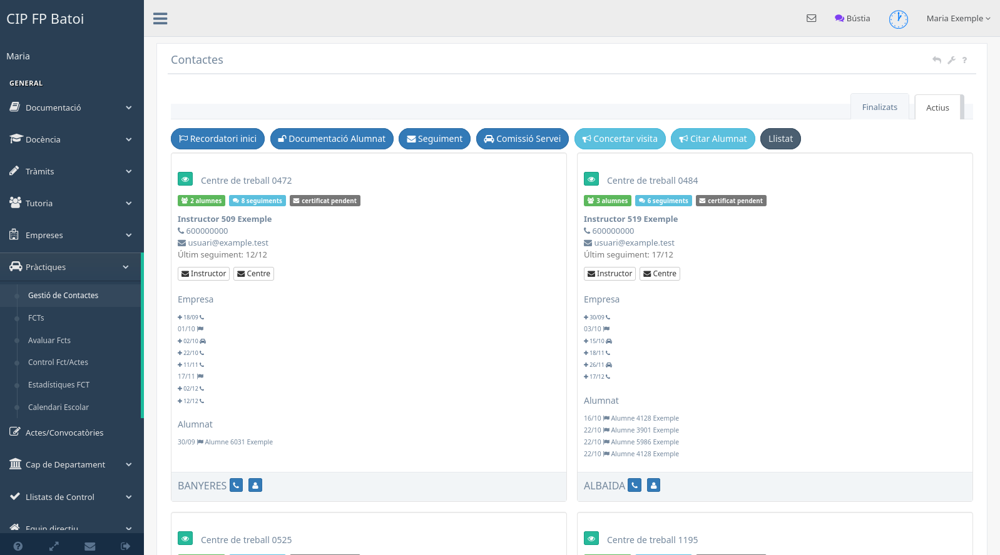
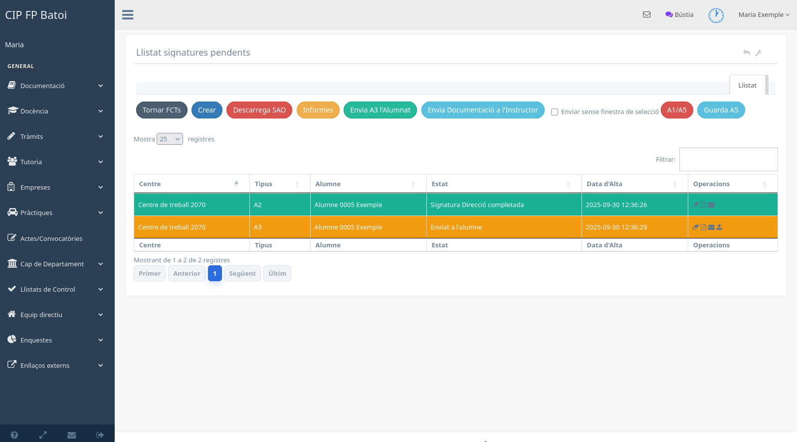

# Manual d'FCT

La intranet acompanya el treball del tutor des de la preparació d'empreses fins
al seguiment i l'avaluació. No substituïx SAO: les dades i documents oficials
que corresponen a SAO s'han de continuar gestionant allí.

## Visió general del procés

1. Revisar empreses, centres de treball, instructors i col·laboracions.
2. Assignar i contactar les empreses del cicle.
3. Preparar les FCT en SAO i importar o sincronitzar les dades necessàries.
4. Gestionar annexos i signatures.
5. Enviar la informació d'inici a empresa i alumnat.
6. Registrar seguiments, telefonades, visites i contactes amb l'alumnat.
7. Avaluar l'FCT i el projecte quan corresponga.
8. Demanar l'acta i conservar la documentació final.

## Preparar empreses i col·laboracions

Abans de crear una FCT s'ha de comprovar que existixen:

- l'empresa;
- almenys un centre de treball;
- la col·laboració amb el cicle;
- l'instructor o instructora amb dades de contacte suficients.

Consulta estos manuals:

- [Empreses i centres de treball](manual-fct-empreses.md)
- [Col·laboracions del departament](manual-fct-gestio-contactes.md)
- [Les meues col·laboracions](manual-fct-meues-colaboracions.md)

Les empreses sense concert i les empreses Erasmus tenen pantalles específiques
i no s'han de confondre amb el llistat ordinari de col·laboracions.

## Gestionar l'alumnat

La pantalla **Pràctiques → FCT x alumne/a** reunix les dades de cada pràctica,
els accessos a SAO, els informes i les signatures. S'explica en
[FCT de l'alumnat](manual-fct-alumno.md).

## Seguiment de pràctiques

La pantalla **Pràctiques → FCTs** està orientada al treball diari: recordatoris
d'inici, correus, telefonades, visites, comissions i contactes amb l'alumnat.
Consulta el [panell de seguiment](manual-fct-panel.md).

Cada contacte real ha de quedar registrat amb la data i un resum útil. Les
comissions de servei associades a visites constituïxen també una evidència del
seguiment.

## Signatures digitals

Des de **Signatures digitals** es gestionen els annexos pendents.

La taula mostra el centre, el tipus de document, l'alumne, l'estat i la data
d'alta. Les accions disponibles depenen del tipus i del progrés de la firma:

- crear o importar documents des de SAO;
- enviar Annex III a l'alumnat;
- enviar la documentació a l'instructor;
- descarregar o pujar documents firmats;
- preparar l'Annex V;
- consultar el PDF i l'estat de cada signatura.

En els enviaments múltiples, la intranet agrupa els documents per destinatari.
Abans d'enviar cal comprovar que instructor o alumne tenen nom i correu vàlids.
No s'han de modificar manualment els indicadors d'enviament o firma.

## Avaluació i tancament

L'avaluació d'FCT, el projecte i la petició d'acta es descriuen en
[Avaluació d'FCT](manual-fct-avaluacio.md). Abans de tancar el procés cal
comprovar que la qualificació, les hores, els documents i la inserció laboral
estiguen correctament registrats.
