# Manual del professorat

Este manual descriu les pantalles comunes de la intranet. Les opcions exactes
del menú depenen dels rols assignats a cada persona: professorat, tutoria, cap
de departament, tutoria d'FCT o direcció.

## Entrada

En la pantalla d'accés cal seleccionar el perfil de professorat i identificar-se
amb el codi o el correu del centre i la contrasenya personal.

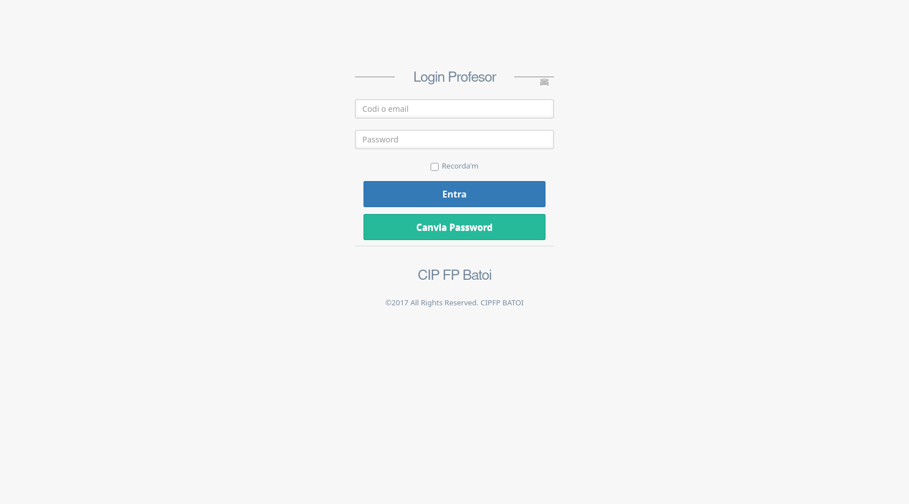

Si no es recorda la contrasenya, s'ha d'utilitzar l'opció de recuperació i
seguir l'enllaç rebut al correu. No s'han de compartir les credencials ni
guardar-les en equips d'ús públic.

## Pàgina d'inici

Des de qualsevol pantalla es pot tornar a l'inici amb el nom del centre o amb
l'opció corresponent del menú. La barra lateral agrupa les funcions disponibles
i es pot plegar per guanyar espai.

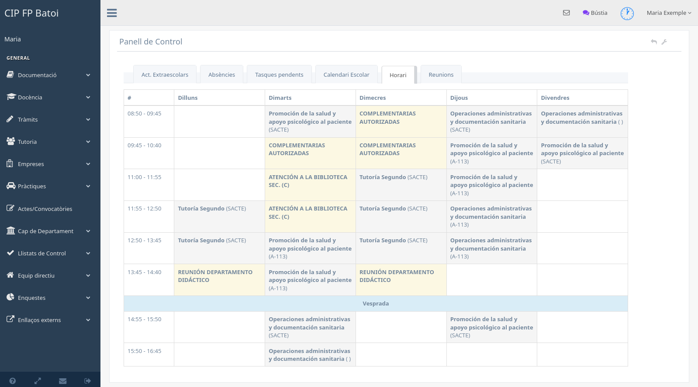

La capçalera dona accés a les notificacions, al control de presència i al menú
personal. Les pestanyes centrals mostren informació de treball com l'horari,
les activitats, les absències, les tasques pendents o les actes. El contingut
pot variar segons el moment del curs i els rols de l'usuari.

### Control de presència

El control de presència permet registrar l'entrada o l'eixida del centre. La
icona de la capçalera mostra l'estat actual. També es pot utilitzar l'enllaç
personal de fitxatge des del mòbil quan la configuració del centre ho permet.

Tancar la sessió i registrar l'eixida són accions diferents; cal comprovar
l'estat de presència abans d'abandonar el centre.

### Notificacions

La icona del sobre mostra les notificacions pendents. Poden ser avisos enviats
per altres persones o generats automàticament per activitats, reunions,
absències i altres tràmits. En obrir-les es pot consultar el detall i eliminar
les que ja no siguen necessàries.

## Perfil i fitxers personals

La pantalla de perfil permet revisar i modificar les dades personals que
l'aplicació deixa editables, com ara el correu, el telèfon visible, la localitat
o l'idioma.

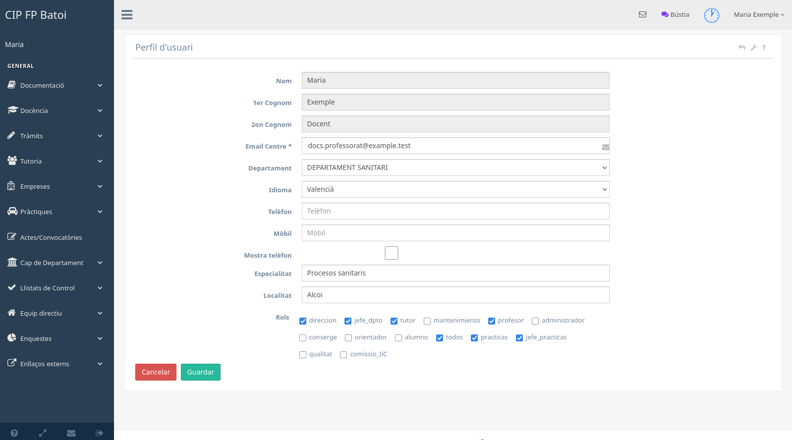

### Fitxers personals

Des del perfil es gestionen els fitxers que utilitzen alguns documents:

- foto de perfil;
- rúbrica o firma gràfica;
- peu dels correus;
- certificat digital, quan el flux d'FCT el requerix.

La rúbrica és necessària per a tràmits que generen resolucions firmades, com
els assumptes particulars. Estos fitxers són personals i no s'han de reutilitzar
entre usuaris.

## Menú Documentació

### Totes les programacions

Mostra les programacions disponibles del centre. Les accions depenen del rol i
de l'estat del document; la consulta general no implica permís per modificar-lo.

### Procediments de gestió i informació de centre

Estes opcions donen accés a documents comuns, procediments i informació interna
publicada pel centre. El contingut el determina la configuració documental de
cada curs.

### Actes, projectes i gestor documental

Permeten consultar actes, documentació de projectes i arxius conservats per la
intranet. Els documents protegits només apareixen per als perfils autoritzats.

## Menú Docència

### Gestió de grups

Mostra els grups relacionats amb el professorat i les accions disponibles sobre
l'alumnat i la docència.

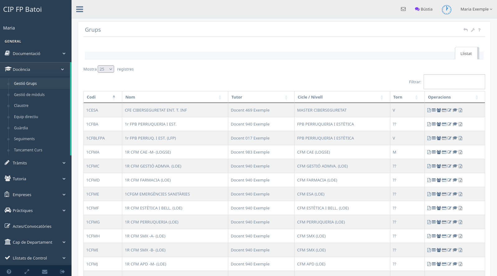

En funció del rol es pot obrir el detall del grup, consultar l'alumnat, gestionar
informació tutorial o accedir a altres operacions del grup.

### Gestió de mòduls

Reunix els mòduls impartits pel professor i els accessos a la seua informació
acadèmica.

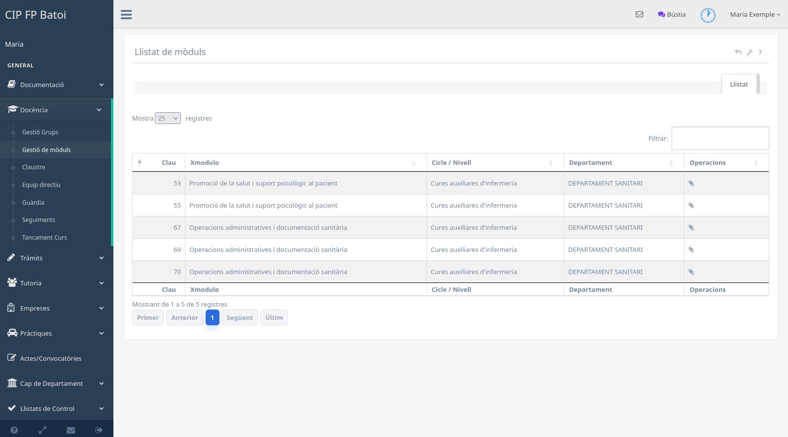

Les icones de cada registre indiquen les accions disponibles. Si es manté el
punter damunt d'una icona, se'n mostra la descripció.

### Claustre i equip directiu

Estos directoris permeten localitzar el professorat, consultar-ne l'horari i
enviar notificacions internes quan l'opció està disponible. La informació
personal visible depén de les preferències de cada usuari.

### Guàrdia

La pantalla de guàrdies mostra les sessions assignades i permet registrar-ne la
realització o anotar una incidència personal.

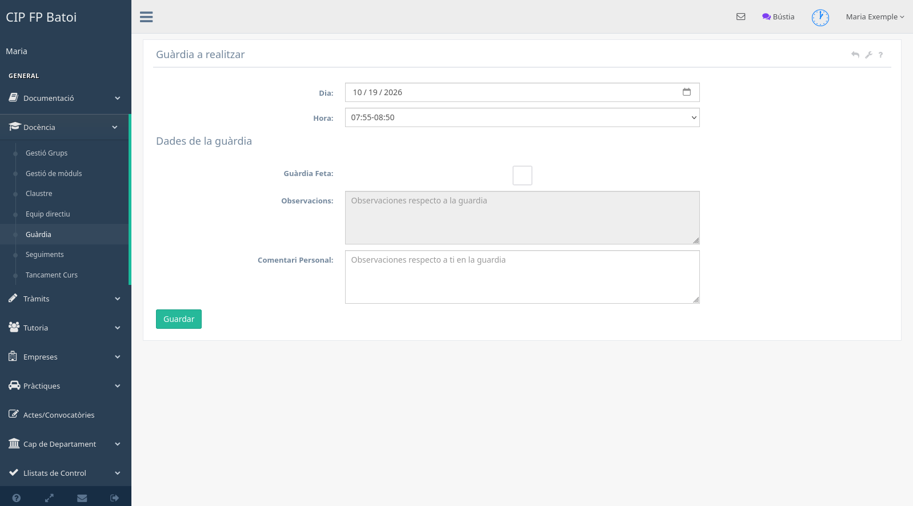

Només es poden confirmar les guàrdies que complixen les condicions temporals i
de xarxa configurades. Els comentaris sobre una guàrdia i els comentaris
personals tenen finalitats diferents i s'han d'emplenar en el camp adequat.

### Seguiments

En acabar cada avaluació, esta pantalla permet registrar els resultats i el
seguiment de la programació dels grups i mòduls impartits.

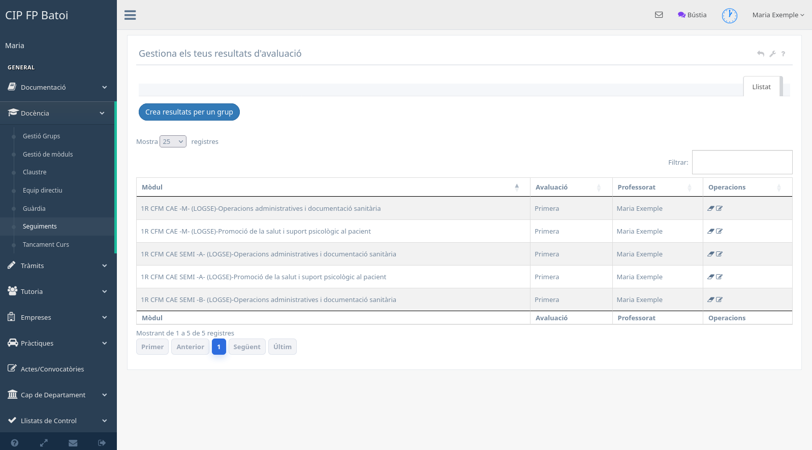

Per a cada seguiment s'indiquen el grup, el mòdul, l'avaluació, les dades de
matrícula i resultats, les unitats programades i impartides i les observacions.

### Tancament de curs

Agrupa les tasques que queden pendents abans de tancar el curs. La relació es
genera amb les dades i terminis actius, per la qual cosa pot canviar al llarg de
l'any.

## Menú Tràmits

### Expedients

Permet crear i tramitar expedients de l'alumnat. Un expedient guardat continua
com a esborrany fins que s'envia formalment a direcció. Després de l'enviament,
les operacions disponibles depenen del tipus i de l'estat de l'expedient.

Les sol·licituds a Orientació disponibles per al rol de tutoria s'expliquen en
el [manual de tutoria](manual-tutor.md#sol·licituds-a-orientació).

### Activitats extraescolars

Mostra les activitats en què participa el professorat i permet crear-ne de
noves quan es disposa de permís.

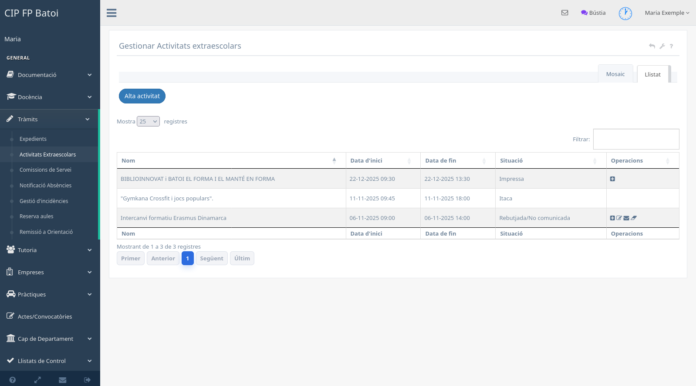

El flux habitual és crear l'activitat, completar participants i grups, enviar-la
a autorització i, quan correspon, avisar el professorat i generar les
autoritzacions de menors. Una activitat no s'ha de considerar autoritzada fins
que el seu estat ho indique.

### Comissions de servei

Esta pantalla gestiona les comissions associades a visites, activitats i altres
desplaçaments.

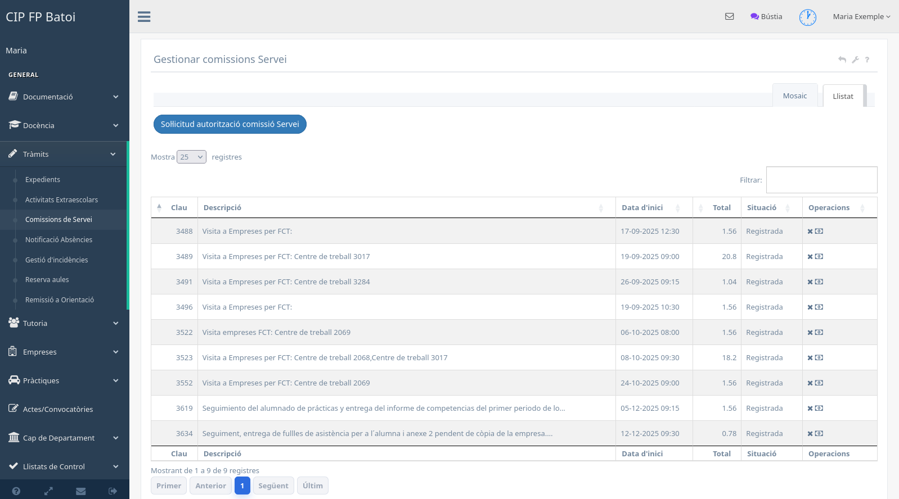

Una comissió pot passar per diferents estats: esborrany o no autoritzada,
pendent, autoritzada, registrada, pendent de cobrament, cobrada o anul·lada.
Les accions de modificar, anul·lar o cobrar només apareixen quan l'estat ho
permet.

### Assumptes particulars

Permet consultar el saldo del curs, comprovar una data i presentar una petició
pròpia.

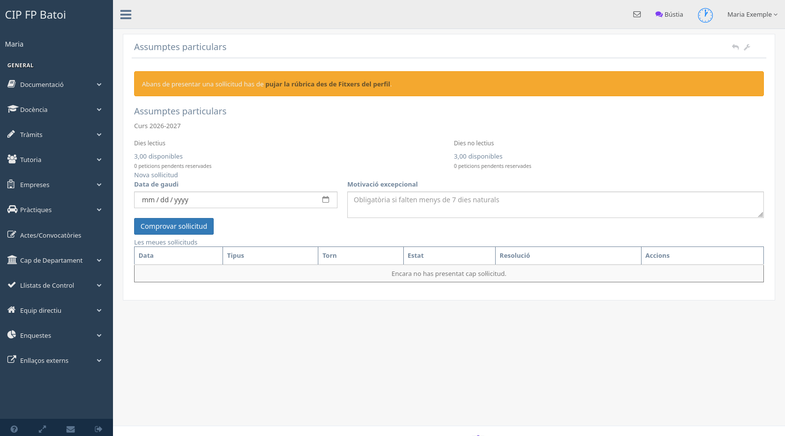

Cal tindre en compte estes regles:

- hi ha bosses independents de dies lectius i no lectius, prorratejades segons
  el nomenament;
- només les peticions autoritzades consumixen saldo;
- no es poden demanar dissabtes, diumenges ni festius;
- la petició ordinària es presenta entre set dies naturals i un mes abans;
- amb menys de set dies cal indicar una motivació excepcional;
- no es permeten dies lectius consecutius, inclòs divendres i dilluns;
- és necessari tindre la rúbrica gràfica configurada en els fitxers personals.

La petició queda pendent fins que Direcció la resol. Si s'autoritza, es genera
la resolució firmada i l'absència corresponent. El document només és accessible
per la persona sol·licitant i els perfils autoritzats.

### Notificació d'absències

Permet comunicar una absència prevista o justificar-ne una d'imprevista.

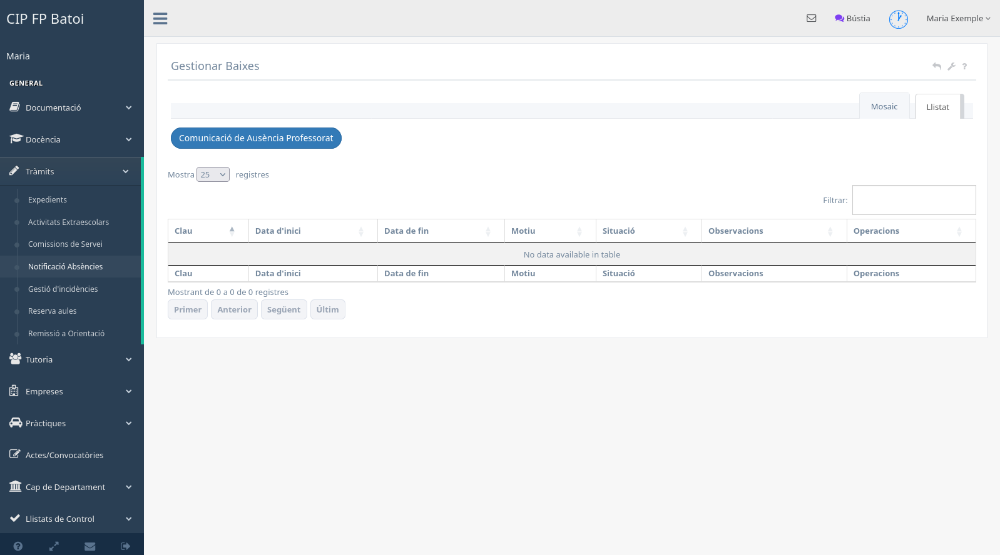

En crear-la s'indiquen les dates i hores, el motiu, les observacions i, si cal,
el justificant. Guardar i tramitar no són sempre la mateixa acció: cal comprovar
que l'absència s'ha enviat a direcció i consultar-ne l'estat posterior.

### Gestió d'incidències

Mostra les incidències comunicades i permet donar-ne d'alta una de nova.

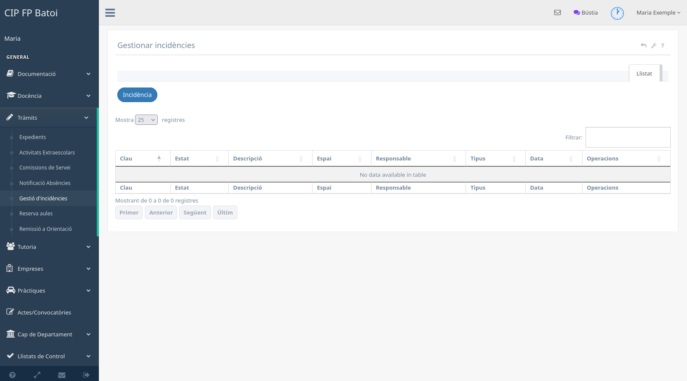

En una incidència s'ha de seleccionar el tipus, l'espai o material afectat quan
corresponga, descriure el problema i indicar-ne la prioritat. L'estat permet
saber si està pendent, en procés o resolta.

### Reserva d'aules

Permet consultar l'ocupació d'un espai en una data i reservar un interval
disponible.

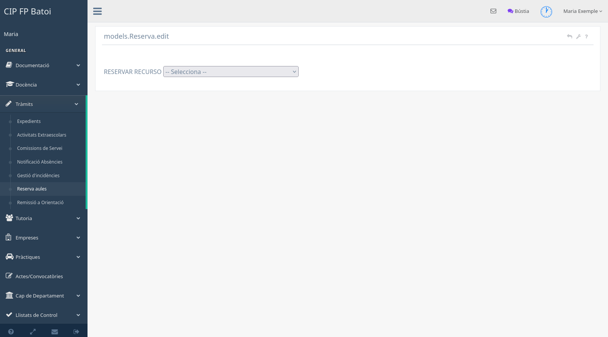

Una reserva només es crea si totes les hores seleccionades estan lliures. Cada
professor pot alliberar les seues reserves; l'alliberament de reserves d'altres
persones requerix el perfil corresponent.

### Sol·licitar canvi d'horari

Quan el període està obert, esta opció permet preparar una proposta temporal
d'horari. Els canvis es poden editar fins que s'envien i queden aprovats. Cal
indicar en les observacions la destinació de les hores alliberades.

## Menú Enquestes

### Resultats

Permet consultar els resultats de les enquestes disponibles per al perfil.

### Realitzar

Mostra les enquestes que el professorat pot crear o respondre, incloses les de
valoració docent, activitats o FCT segons el rol.

### Gestió de documentació

Dona accés als documents de qualitat que el centre publica per a consulta.

El rol de tutoria pot disposar de l'acta FSE entre les opcions de reunions i
convocatòries. El tractament de reunions s'explica en el
[manual de tutoria](manual-tutor.md#reunions-dequip-educatiu).

## Menú Actes i convocatòries

### Gestió de reunions

Mostra les reunions a les quals està convocada la persona usuària i les actes o
documents associats.

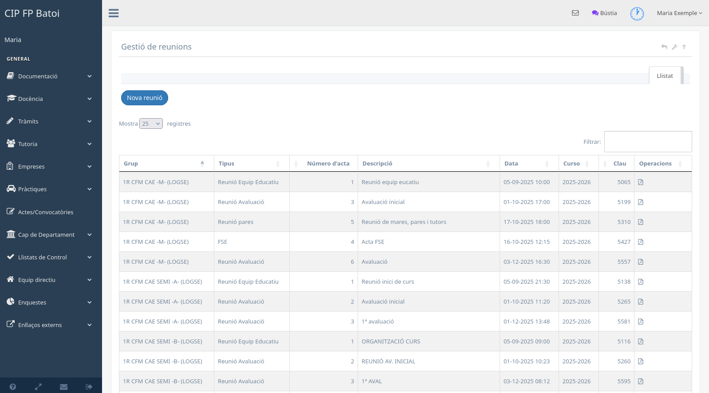

Els perfils autoritzats poden crear reunions, gestionar assistents i redactar
l'acta. La resta del professorat pot consultar la informació que li correspon.

### Grups de treball

Permet consultar els grups de treball propis i, quan es disposa de permís,
crear-ne o gestionar-ne un.

## Col·laboracions i FCT

Les opcions d'FCT apareixen al professorat que té el rol corresponent:

- [Col·laboracions del departament](manual-fct-gestio-contactes.md): consulta
  global, filtres acumulatius i accés al detall de cada cicle.
- [Les meues col·laboracions](manual-fct-meues-colaboracions.md): assignació,
  contacte i classificació de les col·laboracions pròpies.
- [Manual d'FCT](manual-fct.md): alumnat, documentació i seguiment de les
  pràctiques.

## Treballar amb llistats

Moltes pantalles compartixen les mateixes eines:

- **Cerca o filtres:** reduïxen els registres visibles.
- **Ordenació:** es fa polsant la capçalera d'una columna.
- **Paginació:** permet avançar o canviar la quantitat de registres visibles.
- **Llistat i mosaic:** canvien la presentació sense modificar les dades.
- **Icones d'acció:** obrin el detall, l'edició, l'enviament o l'eliminació
  segons els permisos i l'estat.

Abans d'executar una acció irreversible, cal revisar el registre i el missatge
de confirmació. Si una opció descrita en este manual no apareix, el primer que
s'ha de comprovar és el rol de l'usuari i l'estat de l'element.
