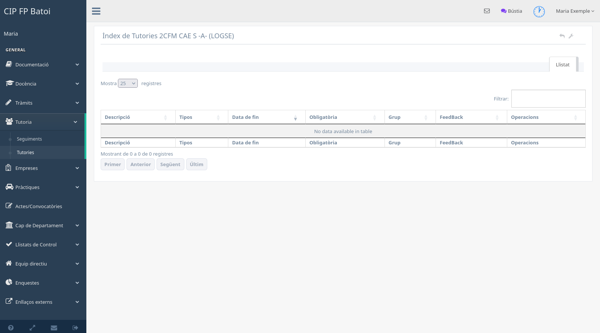

# Manual de tutoria

Este manual descriu les funcions que s'afigen al perfil del professorat quan
una persona és tutora d'un grup. Per a les opcions comunes, consulta el
[manual del professorat](manual-profe.md).

## Accés i grup tutoritzat

El rol de tutoria és acumulatiu: es mantenen totes les opcions docents i
apareixen noves accions sobre el grup tutoritzat. El grup s'obté de l'assignació
vigent del curs; si no hi ha cap grup associat, les pantalles de tutoria poden
mostrar un avís i no permetre continuar.

## Gestió del grup

En **Docència → Gestió de grups**, el tutor pot obrir l'alumnat del seu grup i
accedir a les operacions autoritzades sobre cada fitxa. Segons la configuració,
pot actualitzar dades editables de l'alumne, assignar subgrups o posicions i
generar documents del grup.

Les dades acadèmiques sensibles només s'han d'utilitzar per a la funció
tutorial. No s'han de copiar contrasenyes ni informació personal fora de la
intranet.

## Seguiments del grup

El menú **Tutoria → Seguiments** reunix els seguiments que el professorat de
l'equip educatiu ha registrat. Servix per preparar la visió conjunta del grup i
detectar mòduls que encara no han completat la informació de l'avaluació.

## Tutories d'Orientació

El menú **Tutoria → Tutories** mostra les propostes preparades per Orientació
per al grup assignat.

Cada fila pot mostrar:

- descripció i tipus de tutoria;
- data límit i caràcter obligatori;
- grup afectat;
- estat del retorn o *feedback*;
- documentació i accions disponibles.

Quan el grup realitza una tutoria, cal obrir l'acció de retorn, indicar la data
i registrar el resultat o les observacions. El document original es consulta
des de la mateixa fila quan està disponible.

## Sol·licituds a Orientació

Des de **Tràmits → Sol·licituds** el tutor pot remetre una situació a
Orientació. Cal seleccionar l'alumne, descriure el motiu amb informació
professional i suficient, i consultar després l'estat de la petició.

Una sol·licitud no substituïx les comunicacions urgents ni els protocols
específics del centre.

## Expedients

En crear un expedient, el rol de tutoria dona accés als tipus vinculats al
seguiment del grup, com la pèrdua d'avaluació contínua, la baixa per
inassistència o altres procediments configurats.

Guardar l'expedient no sempre significa tramitar-lo. Cal revisar l'estat i
enviar-lo a Direcció quan la pantalla mostre l'acció corresponent. Una vegada
tramés, les modificacions queden limitades pel flux de resolució.

## Reunions d'equip educatiu

El tutor pot crear reunions d'equip educatiu des de **Actes/Convocatòries →
Gestió de reunions**.

El procés habitual és:

1. Crear la reunió amb tipus, data, número, espai i descripció.
2. Revisar els participants proposats i completar-los si cal.
3. Preparar l'ordre del dia.
4. Enviar la convocatòria o una notificació als participants.
5. Després de la reunió, emplenar el resum de cada punt.
6. Generar l'acta i guardar-la en el gestor documental quan estiga tancada.

La pantalla general de reunions i les accions comunes estan explicades en el
[manual del professorat](manual-profe.md#gestió-de-reunions).

## Projectes i gestor documental

Quan el perfil i el grup ho permeten, el tutor pot incorporar projectes de
l'alumnat al gestor documental. Cal indicar el curs, l'autoria, el títol o
descripció, les etiquetes i el fitxer definitiu. Si el projecte té diversos
fitxers, s'ha de preparar el paquet segons el criteri documental del centre.

## Tutoria d'FCT

Ser tutor de grup no implica necessàriament gestionar pràctiques. Quan també es
disposa del rol corresponent, apareixen els menús **Empreses** i **Pràctiques**.
El procés complet es documenta en el [manual d'FCT](manual-fct.md).
